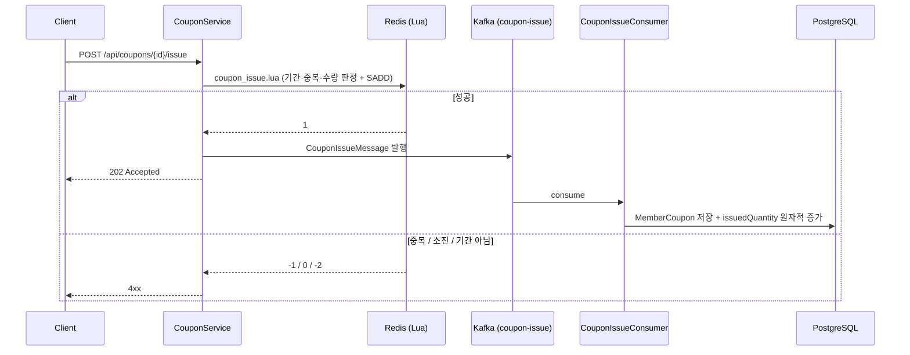
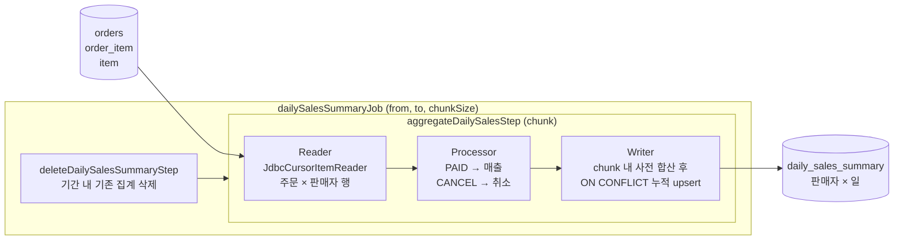
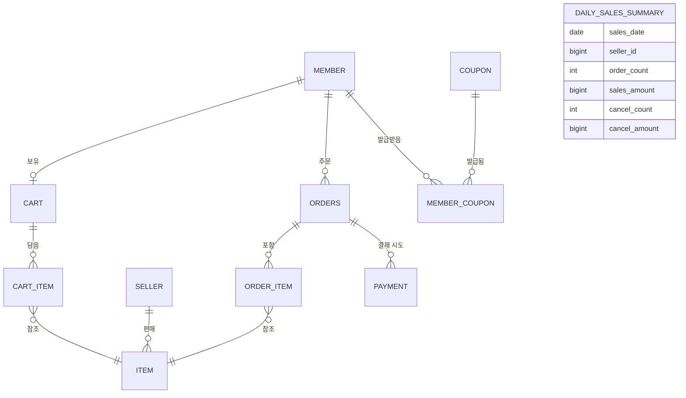

# 🛒 Home Shopping Backend

선착순 쿠폰 발급, 한정 수량 결제처럼 **대량 동시 요청이 한 자원에 몰리는 상황**과, 주문 1,000만 건 규모의 **대용량 데이터를 배치로 집계하는 상황**에서 데이터 정합성과 처리 성능을 지키는 것을 목표로 한 Spring Boot 기반 이커머스 백엔드입니다.
기능 구현보다 문제를 직접 재현하고(JUnit 동시성 테스트, k6 부하 테스트, 대용량 데이터 실험) 원인을 진단해 수치로 개선하는 데 집중했습니다.

- Frontend: [shyuk113/home-shopping-frontend](https://github.com/shyuk113/home-shopping-frontend)
- 배포 가이드: [DEPLOY.md](./DEPLOY.md) · 인프라 구성: [INFRASTRUCTURE.md](./INFRASTRUCTURE.md)

---

## 기술 스택

| 분류 | 기술 |
|---|---|
| Language | Java 21 |
| Framework | Spring Boot 4.0.2, Spring Data JPA / Hibernate |
| Batch | Spring Batch 6 (JDBC JobRepository), JdbcTemplate batch insert |
| Security | Spring Security, JWT (jjwt 0.11.5), BCrypt |
| Database | PostgreSQL 16 (local / prod), H2 (기본 프로필·테스트) |
| Cache | Redis 7 — Spring Cache(`@Cacheable`) 상품 캐싱 |
| 동시성 제어 | Redis Lua Script (선착순 판정), DB 원자적 UPDATE (재고·발급 수량) |
| Messaging | Apache Kafka 3.9 — 쿠폰 발급 DB 저장 비동기화, DLT |
| Infra | Docker, Docker Compose, AWS EC2, Nginx |
| Test | JUnit 5, ExecutorService / CountDownLatch, k6 |
| Build | Gradle |

---

## 주요 기능

- **인증 / 회원**: 회원가입(BCrypt, 이메일 중복 체크), 로그인(JWT 발급), 회원 정보 조회·수정
- **상품 / 판매자**: 목록·상세 조회(Redis 캐싱), 카테고리별 페이징 조회, 등록·수정·삭제(ADMIN), 변경 시 캐시 무효화. 모든 상품은 판매자(`Seller`)에 속함
- **장바구니**: 상품 추가(이미 담긴 상품이면 수량 합산), 조회, 삭제
- **주문**: 주문 생성(`PENDING`), 목록·단건 조회, 취소(결제 완료 건은 재고 복구)
- **결제**: 결제 요청 → 승인 확정(**이 시점에 재고 차감**) → 조회 / 취소, Redis 기반 결제 실패 급증 감지
- **쿠폰**: 쿠폰 생성, Redis Lua + Kafka 기반 선착순 발급, 내 쿠폰 조회
- **일별 매출 집계 배치**: Spring Batch로 주문 원본을 판매자 × 일 단위로 집계해 `daily_sales_summary`에 저장 (판매자 대시보드용)
- **대용량 더미 데이터 시더**: 주문 1,000만 / 주문상품 2,000만 건을 JDBC batch insert로 적재 (`local` 프로필 전용)

---

## 아키텍처

### 패키지 구조

각 도메인이 `domain / application / infrastructure / presentation` 4계층을 동일하게 반복합니다.

```
com.shop.backend
├── auth        회원가입 / 로그인
├── member      회원 정보
├── seller      판매자
├── Item        상품 (Redis 캐싱, 판매자 소속)
├── cart        장바구니
├── order       주문 (PENDING / 결제완료 / 취소 / 실패)
├── payment     결제 승인 흐름, 결제 실패 모니터링
├── coupon      선착순 쿠폰 (Lua 판정 + Kafka Producer / Consumer)
├── sales
│   ├── domain          DailySalesSummary (조회 전용 엔티티)
│   ├── infrastructure  DailySalesSummaryRepository
│   └── batch           일별 매출 집계 Job (Reader / Processor / Writer)
├── common      BaseEntity, Address 등 공통 임베디드 타입
└── global
    ├── config      Security, Redis, Kafka 에러 핸들러, Lua 스크립트 빈
    ├── batch       JobResultLoggingListener (Job·Step 소요 시간 / 처리 건수 로깅)
    ├── seed        DummyDataSeeder (대용량 더미 데이터 적재)
    ├── jwt         JwtProvider, JwtAuthenticationFilter
    └── exception   GlobalExceptionHandler, 커스텀 예외
```

대량 적재 전용 저장소(`OrderBulkRepository`, `ItemBulkRepository`)는 JPA 레포지토리와 분리해 각 도메인의 `infrastructure`에 둡니다. IDENTITY 전략에서는 Hibernate batch insert가 비활성화되기 때문에 `JdbcTemplate.batchUpdate`로 직접 적재하고, 영속성 컨텍스트를 우회한다는 점을 이름(`Bulk`)으로 드러냅니다.

### 선착순 쿠폰 발급 흐름



- 요청 스레드는 **DB에 전혀 접근하지 않고** Redis 판정 후 바로 응답 → 스파이크 트래픽을 DB 커넥션 풀이 아닌 Redis가 흡수
- Kafka 발행 실패 시 Redis Set에서 회원을 제거해 보상 처리
- Consumer는 1초 간격 3회 재시도 후 `coupon-issue.DLT`로 이동, `(member_id, coupon_id)` 유니크 제약으로 중복 전달(at-least-once)에 대한 멱등성 확보
- 쿠폰 메타 정보는 DB 커밋 이후(`afterCommit`)에만 Redis에 적재해 롤백 시 유령 쿠폰 방지

### 일별 매출 집계 배치 흐름



- **멱등성**: Writer가 누적 upsert이므로, 첫 Step에서 대상 기간 집계를 지우고 다시 쌓아 같은 기간을 몇 번 돌려도 결과가 같음
- **재시작**: 실행 이력과 진행 위치가 `BATCH_*` 메타데이터에 남아, 실패한 Job을 같은 파라미터로 다시 실행하면 완료된 Step은 건너뛰고 실패 지점부터 이어서 처리
- **Reader 단위**: "주문 1건이 판매자 1명에게 만든 매출" 단위로 읽어, 한 주문에 같은 판매자 상품이 여러 개여도 주문 수가 중복 집계되지 않음

---

## 핵심 설계 — 동시성 제어

| 자원 | 방식 | 이유 |
|---|---|---|
| 선착순 쿠폰 판정 | Redis Lua Script (`HMGET` → `SISMEMBER` → `SCARD` → `SADD`) | 기간·중복·수량 체크와 발급 기록을 하나의 원자 연산으로 처리. 이전의 `SET + INCR` 분리 방식에서 생기던 보상 로직과 경합 구간 제거 |
| 쿠폰 DB 반영 | Kafka 비동기 처리 + 유니크 제약 | 요청 응답 시간과 DB 쓰기를 분리, 재전달 메시지는 유니크 제약으로 무시 |
| 쿠폰 발급 통계(`issuedQuantity`) | `UPDATE ... SET issuedQuantity = issuedQuantity + 1` | Dirty Checking 방식의 Lost Update 방지 |
| 재고 (결제 확정 시) | `UPDATE ... SET quantity = quantity - :qty WHERE id = :id AND quantity >= :qty` | 비관적 락 대기 대신 DB가 체크와 차감을 원자적으로 처리. 영향받은 row 수(0/1)로 성공 여부 판단 |
| 상품 캐시 | 수정 커밋 이후 지연 삭제(Delayed Double Delete, 500ms) | 커밋 전 캐시 삭제 → 다른 요청이 옛 값을 다시 캐싱하는 문제 완화 |

**재고 차감 시점**: 주문 생성이 아니라 **결제 확정(`PaymentService.confirm()`)** 시점입니다. 주문 생성 시에는 `PENDING` 상태만 만들고 재고는 소프트 체크만 합니다.

---

## 핵심 설계 — 대용량 데이터 처리

### 1. 대용량 더미 데이터 적재

인덱스·배치 최적화 효과는 데이터가 충분히 커야 측정되므로, 1년치 주문 데이터를 먼저 적재했습니다.

| 항목 | 값 |
|---|---|
| 데이터 | 주문 **1,000만** / 주문상품 **약 2,000만** / 상품 10만 / 판매자 1,000 (약 2.8GB) |
| 분포 | 최근 365일 균등 분포(하루 약 2.74만 건), 상태 PAID 85 / CANCEL 7 / PENDING 5 / FAILED 3% |
| 적재 시간 | **약 13분** (전체 약 3.8만 행/초), 테이블이 커져도 처리량 저하 없음 |

- `orders` ID를 시퀀스에서 미리 할당(`nextval` + `generate_series`)해, batch insert로는 돌려받기 어려운 생성 키 없이도 `order_item.order_id`를 채움
- 1만 건 단위 트랜잭션, 1천 건 단위 batch, 중단 후 재실행 시 남은 건수만 이어서 적재

**PostgreSQL JDBC `reWriteBatchedInserts` 효과** (10만 건, 각 3회 측정 중앙값)

| 대상 | OFF | ON | 개선 |
|---|---|---|---|
| 상품 10만 행 | 3.98s | 1.90s | **2.1배** |
| 주문·주문상품 29.5만 행 | 11.2s | 7.6s | **32% 단축** |

주문상품은 행마다 FK 검사·인덱스 갱신 비용이 그대로 남아 상품보다 개선 폭이 작습니다. (2차례 독립 실험에서 같은 경향 재현)

### 2. 일별 매출 집계 배치

| 설계 | 이유 |
|---|---|
| `connectionAutoCommit(false)` + `fetchSize` | PostgreSQL 드라이버는 기본 설정에서 결과 전체를 메모리로 가져온다. 두 설정이 있어야 커서처럼 나눠 받는다 |
| Reader 반환 타입을 `JdbcCursorItemReader`로 선언 | `@StepScope` 프록시가 `ItemStream`을 구현해야 Step이 open/update/close를 호출하고 재시작 위치가 저장된다 |
| `ORDER BY 날짜, 판매자, 주문ID` | ① 같은 집계 키가 연달아 나와 chunk 내 사전 합산 효율이 높아지고 ② 정렬이 항상 같아 재시작 시 커서 위치가 재현된다 |
| Writer에서 키별로 먼저 합친 뒤 upsert | 한 배치에 같은 키가 여러 번 들어가면 multi-row INSERT에서 `ON CONFLICT ... cannot affect row a second time` 에러가 난다 |
| 집계 테이블에 FK 없음, 엔티티는 조회 전용 | 원본에서 파생된 데이터라 FK 이득이 없고 대량 쓰기 비용만 늘어난다. 쓰기는 배치(JDBC)만 담당 |

**성능 개선: Writer 병목 제거** (9월 1개월, 151만 행, chunk 1,000)

처리 시간의 94%가 Writer upsert였습니다(Reader 쿼리 단독 14.1s / Job 238.9s). 주문 ID 순으로 읽으면 chunk 안에서 같은 (판매자, 날짜)가 거의 겹치지 않아 행마다 UPDATE가 발생했고, 정렬 키를 집계 키 순서로 바꿔 해결했습니다.

| 지표 | 변경 전 (`ORDER BY 주문ID`) | 변경 후 (`ORDER BY 날짜, 판매자, 주문ID`) |
|---|---|---|
| Job 소요 시간 | 238.9s | **89.8s (2.7배 단축)** |
| summary UPDATE 횟수 | 1,458,538 | **1,489 (약 980배 감소)** |
| summary 테이블 크기 | 177MB | 7.7MB |

**정확성 검증**: 원본 SQL 직접 집계와 30,000행(판매자 1,000 × 30일)을 양방향 `EXCEPT`로 비교해 불일치 0건. 같은 기간 재실행 시에도 결과 동일.

---

## API 명세

`/api/auth/**`, `GET /api/items/**`를 제외한 모든 API는 `Authorization: Bearer <JWT>` 헤더가 필요합니다.

### Auth (`/api/auth`)
| Method | URL | 설명 |
|---|---|---|
| POST | /api/auth/signup | 회원가입 |
| POST | /api/auth/login | 로그인 (JWT 발급) |

### Member (`/api/members`)
| Method | URL | 설명 |
|---|---|---|
| GET | /api/members/{id} | 회원 정보 조회 |
| PUT | /api/members/{id} | 회원 정보 수정 |

### Item (`/api/items`)
| Method | URL | 설명 | 권한 |
|---|---|---|---|
| GET | /api/items | 전체 상품 조회 | 누구나 |
| GET | /api/items/{id} | 상품 상세 조회 | 누구나 |
| GET | /api/items/category?category={category} | 카테고리별 페이징 조회 | 누구나 |
| POST | /api/items | 상품 등록 (요청 본문에 `sellerId` 필수) | ADMIN |
| PUT | /api/items/{id} | 상품 수정 | ADMIN |
| DELETE | /api/items/{id} | 상품 삭제 | ADMIN |

### Cart (`/api/cart`)
| Method | URL | 설명 |
|---|---|---|
| POST | /api/cart | 장바구니 상품 추가 |
| GET | /api/cart | 장바구니 조회 |
| DELETE | /api/cart/{itemId} | 장바구니 상품 삭제 |

### Order (`/api/orders`)
| Method | URL | 설명 |
|---|---|---|
| POST | /api/orders | 주문 생성 (`PENDING`) |
| GET | /api/orders?memberId={id} | 회원 주문 목록 조회 |
| GET | /api/orders/{id} | 주문 단건 조회 |
| DELETE | /api/orders/{id} | 주문 취소 (결제 완료 건만 재고 복구) |

### Payment (`/api/payments`)
| Method | URL | 설명 |
|---|---|---|
| POST | /api/payments | 결제 요청 생성 |
| POST | /api/payments/{paymentKey}/confirm | 결제 승인 확정 (재고 차감) |
| GET | /api/payments/{paymentKey} | 결제 상태 조회 |
| POST | /api/payments/{paymentKey}/cancel | 결제 취소 |

### Coupon (`/api/coupons`)
| Method | URL | 설명 |
|---|---|---|
| POST | /api/coupons | 쿠폰 생성 |
| POST | /api/coupons/{couponId}/issue | 선착순 발급 — `202` 성공 / `400` 중복 / `409` 소진 |
| GET | /api/coupons/my | 내 쿠폰 목록 조회 |

---

## ERD



`DAILY_SALES_SUMMARY`는 배치가 만드는 파생 데이터라 FK 없이 `seller_id`만 보관합니다. `UNIQUE (seller_id, sales_date)`가 대시보드 조회(판매자 등치 + 기간 범위)와 배치 upsert의 기준 키입니다.

---

## 실행 방법

### 1. 인프라 실행 (PostgreSQL · Redis · Kafka)

```bash
docker compose up -d
```

| 서비스 | 포트 |
|---|---|
| PostgreSQL 16 | 5433 (db/user/password: `shop`) |
| Redis 7 | 6379 |
| Kafka 3.9 (KRaft) | 9092 |

### 2. 환경 변수

`JWT_SECRET`은 필수입니다. `.env.example`을 참고하세요.

```bash
export JWT_SECRET=$(openssl rand -base64 64)
```

### 3. 애플리케이션 실행

```bash
./gradlew bootRun --args='--spring.profiles.active=local'
```

| 프로필 | DB | 비고 |
|---|---|---|
| (기본) | H2 in-memory | Redis 필요, 테스트에서 사용 |
| `local` | PostgreSQL(5433) | `ddl-auto: create`, `data-postgresql.sql` 시드 로드, `BATCH_*` 메타데이터 테이블 생성 |
| `local,bench` | PostgreSQL(5433) | `ddl-auto: none`, 시드 미실행 → **적재한 1,000만 건을 보존한 채 실행** |
| `prod` | PostgreSQL (환경 변수) | 시드 미실행, `ddl-auto: update` |

> ⚠️ 대용량 데이터를 적재한 뒤에는 반드시 `local,bench`로 실행하세요. `local`만 쓰면 `ddl-auto: create`가 테이블을 다시 만들어 데이터가 사라집니다.

### 4. 대용량 더미 데이터 적재

```bash
./gradlew bootRun --args='--spring.profiles.active=local --seed.enabled=true'
```

| 옵션 | 기본값 | 설명 |
|---|---|---|
| `seed.order-count` | 10,000,000 | 주문 건수 (주문상품은 주문당 1~3개) |
| `seed.item-count` | 100,000 | 상품 건수 (판매자 1,000명에게 균등 배정) |
| `seed.days` | 365 | 주문 시각을 최근 N일에 분산 |

이미 적재된 건수는 건너뛰고 남은 만큼만 이어서 적재합니다. 기존 DB에 판매자·집계 테이블을 추가할 때 사용한 마이그레이션 SQL은 [`docs/`](./docs)에 있습니다.

### 5. 일별 매출 집계 Job 실행

```bash
./gradlew bootRun --args='--spring.profiles.active=local,bench --spring.batch.job.enabled=true --spring.batch.job.name=dailySalesSummaryJob from=2026-09-01,java.time.LocalDate to=2026-09-30,java.time.LocalDate run=1,java.lang.Long'
```

| 파라미터 | 필수 | 설명 |
|---|---|---|
| `from`, `to` | ✅ | 집계 기간 (양 끝 포함). 타입을 붙여 `LocalDate`로 전달 |
| `chunkSize` | | chunk 크기 (기본 1000) |
| `run` | | 같은 기간을 다시 집계할 때 구분용 값 |

- 같은 파라미터로 **성공한** Job은 다시 실행되지 않습니다(`JobInstanceAlreadyCompleteException`). 반복 실행 시 `run` 값을 바꿉니다.
- **실패한** Job은 같은 파라미터로 다시 실행하면 재시작됩니다.
- 실행 결과는 로그(`[batch] job=... elapsed=... ms`)와 `BATCH_JOB_EXECUTION`, `BATCH_STEP_EXECUTION` 테이블에서 확인합니다.

### 운영 배포

```bash
cp .env.example .env   # DB_PASSWORD, JWT_SECRET 수정
docker compose -f docker-compose.prod.yml up -d --build
```

EC2 + Nginx + HTTPS 구성 절차는 [DEPLOY.md](./DEPLOY.md)를 참고하세요.

---

## 테스트

### 단위 / 동시성 테스트

```bash
./gradlew test
```

| 테스트 | 검증 내용 |
|---|---|
| `OrderConcurrencyTest` | 재고 10개 상품의 결제 30건을 동시에 승인(`confirm`)하면 정확히 10건만 성공하고 재고가 0·`SOLD_OUT`이 되는지 |
| `CouponServiceTest` | 수량 100장 쿠폰에 500명 동시 발급 시 Redis 판정 성공 100 / 소진 400, Kafka Consumer 처리 후 DB 저장 100건 (Redis·Kafka 필요) |
| `ItemServiceTest` | `@CachePut` 경쟁 상태 재현, 지연 삭제(Delayed Double Delete)로 오래된 캐시 제거 |
| `PaymentFailureMonitorTest` | 결제 실패 임계치 감지 및 알림 쿨다운 |

> `CouponServiceTest`는 로컬 애플리케이션과 같은 Kafka consumer group을 사용하므로, 애플리케이션을 끈 상태에서 실행합니다.

### 부하 테스트 (k6)

`local` 프로필로 애플리케이션을 띄운 뒤 실행합니다. 시드 데이터(회원 1000명, 상품 1개, `PENDING` 주문 1600건)를 사용합니다.

```bash
k6 run loadtest/coupon-scenario.js
```

```bash
k6 run loadtest/payment-scenario.js
```

| 시나리오 | 내용 | 합격 기준 |
|---|---|---|
| `coupon-scenario.js` | 수량 100장 쿠폰에 1000명 동시 발급 요청 | 정확히 100건만 발급 성공 |
| `payment-scenario.js` | 결제 요청 → 승인 → 조회 흐름을 100 / 500 / 1000 동시 요청으로 실행 | 결제 흐름 성공률, 재고 정합성 |

---

## 트러블슈팅

| 문제 | 원인 | 해결 |
|---|---|---|
| 결제 금액이 0원으로 계산되고 결제 승인 시 재고가 줄지 않음 | `Order.createOrder()`가 연관관계의 주인인 `OrderItem.order`를 설정하지 않아 `order_item.order_id`가 NULL로 저장 | `addOrderItem()`으로 양방향 설정, 빌더에서 `orderItems` 파라미터 제거 |
| 지연 이중 삭제가 stale 캐시를 지우지 못함 | 2차 evict를 `TimeUnit.MICROSECONDS`로 예약해 500ms가 아닌 500μs 뒤에 실행 | `MILLISECONDS`로 수정 |
| 집계 배치 시간의 94%가 Writer에 소요 | 주문 ID 순으로 읽어 chunk 내 같은 집계 키가 거의 없음 → 행마다 UPDATE (146만 회), 테이블 177MB로 부풀음 | Reader 정렬 키를 집계 키 순으로 변경 → UPDATE 1,489회, 238s → 90s |
| PostgreSQL 커서 Reader가 메모리를 과다 사용할 위험 | 드라이버가 autoCommit 상태에서는 결과 전체를 한 번에 가져옴 | `connectionAutoCommit(false)` + `fetchSize` 설정 |

---

## 진행 중인 작업

| 단계 | 내용 | 상태 |
|---|---|---|
| 대용량 데이터 구축 | 주문 1,000만 건 적재, batch insert 최적화 실험 | ✅ 완료 |
| Spring Batch 집계 | 일별 매출 집계 Job, Writer 병목 개선 | ✅ 완료 |
| | Reader 비교 (JdbcCursor / JpaPaging / No-Offset) | 🔄 진행 중 |
| | Chunk size 100 / 1,000 / 5,000 비교, Partitioning 병렬 처리 | ⏳ 예정 |
| | chunk 중간 실패 → 재시작 시연 | ⏳ 예정 |
| 데이터 서빙 API | 판매자 대시보드 조회: 원본 직접 집계 → 집계 테이블 → Redis Cache-Aside 단계별 p95 측정 | ⏳ 예정 |
| 쿼리 튜닝 | `EXPLAIN ANALYZE` 전후 비교 (현재 `orders.order_time`, `order_item.order_id` 인덱스 없음, 9월 Reader 쿼리 14.1s Seq Scan) | ⏳ 예정 |
