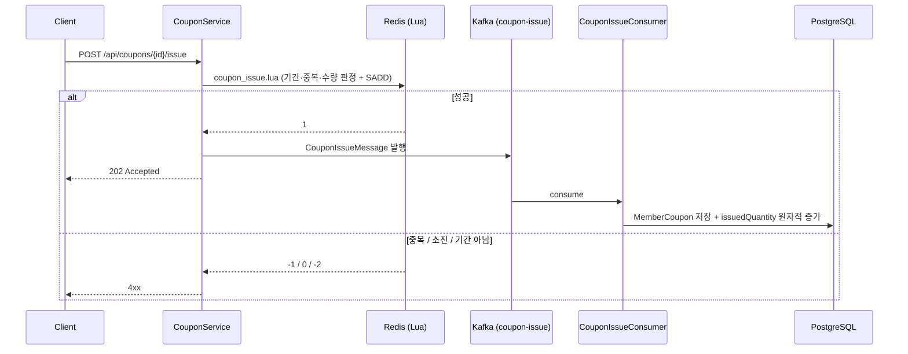
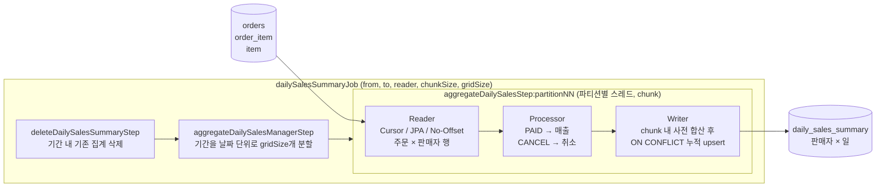
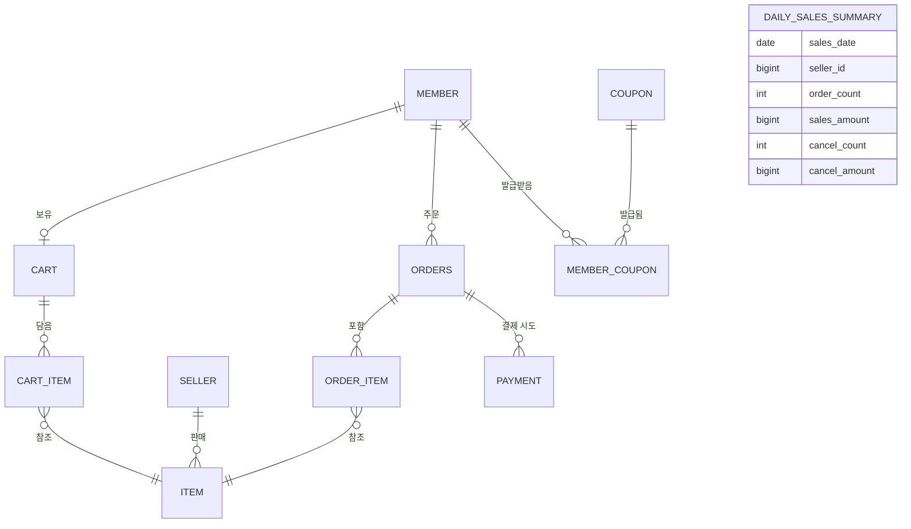

# 🛒 Home Shopping Backend

선착순 쿠폰 발급, 한정 수량 결제처럼 **대량 동시 요청이 한 자원에 몰리는 상황**과, 주문 1,000만 건 규모의 **대용량 데이터를 배치로 집계하는 상황**에서 데이터 정합성과 처리 성능을 지키는 것을 목표로 한 Spring Boot 기반 이커머스 백엔드입니다.
기능 구현보다 문제를 직접 재현하고(JUnit 동시성 테스트, k6 부하 테스트, 대용량 데이터 실험) 원인을 진단해 수치로 개선하는 데 집중했습니다.

- Frontend: [shyuk113/home-shopping-frontend](https://github.com/shyuk113/home-shopping-frontend)
- 배포 가이드: [DEPLOY.md](./DEPLOY.md) · 인프라 구성: [INFRASTRUCTURE.md](./INFRASTRUCTURE.md)

---

## 기술 스택

| 분류 | 기술 |
|---|---|
| Language | Java 21 |
| Framework | Spring Boot 4.0.2, Spring Data JPA / Hibernate |
| Batch | Spring Batch 6 (JDBC JobRepository), JdbcTemplate batch insert |
| Security | Spring Security, JWT (jjwt 0.11.5), BCrypt |
| Database | PostgreSQL 16 (local / prod), H2 (기본 프로필·테스트) |
| Cache | Redis 7 — Spring Cache(`@Cacheable`) 상품 캐싱 |
| 동시성 제어 | Redis Lua Script (선착순 판정), DB 원자적 UPDATE (재고·발급 수량) |
| Messaging | Apache Kafka 3.9 — 쿠폰 발급 DB 저장 비동기화, DLT |
| Infra | Docker, Docker Compose, AWS EC2, Nginx |
| Test | JUnit 5, ExecutorService / CountDownLatch, k6 |
| Build | Gradle |

---

## 주요 기능

- **인증 / 회원**: 회원가입(BCrypt, 이메일 중복 체크), 로그인(JWT 발급), 회원 정보 조회·수정
- **상품 / 판매자**: 목록·상세 조회(Redis 캐싱), 카테고리별 페이징 조회, 등록·수정·삭제(ADMIN), 변경 시 캐시 무효화. 모든 상품은 판매자(`Seller`)에 속함
- **장바구니**: 상품 추가(이미 담긴 상품이면 수량 합산), 조회, 삭제
- **주문**: 주문 생성(`PENDING`), 목록·단건 조회, 취소(결제 완료 건은 재고 복구)
- **결제**: 결제 요청 → 승인 확정(**이 시점에 재고 차감**) → 조회 / 취소, Redis 기반 결제 실패 급증 감지
- **쿠폰**: 쿠폰 생성, Redis Lua + Kafka 기반 선착순 발급, 내 쿠폰 조회
- **일별 매출 집계 배치**: Spring Batch로 주문 원본을 판매자 × 일 단위로 집계해 `daily_sales_summary`에 저장 (판매자 대시보드용). Reader 3종 선택, 날짜 기반 Partitioning, 실패 파티션 단위 재시작 지원
- **대용량 더미 데이터 시더**: 주문 1,000만 / 주문상품 2,000만 건을 JDBC batch insert로 적재 (`local` 프로필 전용)

---

## 아키텍처

### 패키지 구조

각 도메인이 `domain / application / infrastructure / presentation` 4계층을 동일하게 반복합니다.

```
com.shop.backend
├── auth        회원가입 / 로그인
├── member      회원 정보
├── seller      판매자
├── Item        상품 (Redis 캐싱, 판매자 소속)
├── cart        장바구니
├── order       주문 (PENDING / 결제완료 / 취소 / 실패)
├── payment     결제 승인 흐름, 결제 실패 모니터링
├── coupon      선착순 쿠폰 (Lua 판정 + Kafka Producer / Consumer)
├── sales
│   ├── domain          DailySalesSummary (조회 전용 엔티티)
│   ├── infrastructure  DailySalesSummaryRepository
│   └── batch           일별 매출 집계 Job (Reader 3종 / Processor / Writer, 날짜 Partitioner)
├── common      BaseEntity, Address 등 공통 임베디드 타입
└── global
    ├── config      Security, Redis, Kafka 에러 핸들러, Lua 스크립트 빈
    ├── batch       JobResultLoggingListener (Job·Step 소요 시간 / 처리 건수 로깅)
    ├── seed        DummyDataSeeder (대용량 더미 데이터 적재)
    ├── jwt         JwtProvider, JwtAuthenticationFilter
    └── exception   GlobalExceptionHandler, 커스텀 예외
```

대량 적재 전용 저장소(`OrderBulkRepository`, `ItemBulkRepository`)는 JPA 레포지토리와 분리해 각 도메인의 `infrastructure`에 둡니다. IDENTITY 전략에서는 Hibernate batch insert가 비활성화되기 때문에 `JdbcTemplate.batchUpdate`로 직접 적재하고, 영속성 컨텍스트를 우회한다는 점을 이름(`Bulk`)으로 드러냅니다.

### 선착순 쿠폰 발급 흐름



- 요청 스레드는 **DB에 전혀 접근하지 않고** Redis 판정 후 바로 응답 → 스파이크 트래픽을 DB 커넥션 풀이 아닌 Redis가 흡수
- Kafka 발행 실패 시 Redis Set에서 회원을 제거해 보상 처리
- Consumer는 1초 간격 3회 재시도 후 `coupon-issue.DLT`로 이동, `(member_id, coupon_id)` 유니크 제약으로 중복 전달(at-least-once)에 대한 멱등성 확보
- 쿠폰 메타 정보는 DB 커밋 이후(`afterCommit`)에만 Redis에 적재해 롤백 시 유령 쿠폰 방지

### 일별 매출 집계 배치 흐름



- **멱등성**: Writer가 누적 upsert이므로, 첫 Step에서 대상 기간 집계를 지우고 다시 쌓아 같은 기간을 몇 번 돌려도 결과가 같음
- **재시작**: 실행 이력과 진행 위치가 `BATCH_*` 메타데이터에 남아, 실패한 Job을 같은 파라미터로 다시 실행하면 완료된 Step과 파티션은 건너뛰고 실패한 파티션만 마지막 커밋 지점부터 이어서 처리
- **Partitioning**: 파티션을 날짜 단위로 나눠 파티션끼리 같은 (판매자, 날짜) 키를 건드리지 않으므로 병렬 upsert 충돌이 없음
- **Reader 단위**: "주문 1건이 판매자 1명에게 만든 매출" 단위로 읽어, 한 주문에 같은 판매자 상품이 여러 개여도 주문 수가 중복 집계되지 않음

---

## 핵심 설계 — 동시성 제어

| 자원 | 방식 | 이유 |
|---|---|---|
| 선착순 쿠폰 판정 | Redis Lua Script (`HMGET` → `SISMEMBER` → `SCARD` → `SADD`) | 기간·중복·수량 체크와 발급 기록을 하나의 원자 연산으로 처리. 이전의 `SET + INCR` 분리 방식에서 생기던 보상 로직과 경합 구간 제거 |
| 쿠폰 DB 반영 | Kafka 비동기 처리 + 유니크 제약 | 요청 응답 시간과 DB 쓰기를 분리, 재전달 메시지는 유니크 제약으로 무시 |
| 쿠폰 발급 통계(`issuedQuantity`) | `UPDATE ... SET issuedQuantity = issuedQuantity + 1` | Dirty Checking 방식의 Lost Update 방지 |
| 재고 (결제 확정 시) | `UPDATE ... SET quantity = quantity - :qty WHERE id = :id AND quantity >= :qty` | 비관적 락 대기 대신 DB가 체크와 차감을 원자적으로 처리. 영향받은 row 수(0/1)로 성공 여부 판단 |
| 상품 캐시 | 수정 커밋 이후 지연 삭제(Delayed Double Delete, 500ms) | 커밋 전 캐시 삭제 → 다른 요청이 옛 값을 다시 캐싱하는 문제 완화 |

**재고 차감 시점**: 주문 생성이 아니라 **결제 확정(`PaymentService.confirm()`)** 시점입니다. 주문 생성 시에는 `PENDING` 상태만 만들고 재고는 소프트 체크만 합니다.

---

## 핵심 설계 — 대용량 데이터 처리

### 1. 대용량 더미 데이터 적재

인덱스·배치 최적화 효과는 데이터가 충분히 커야 측정되므로, 1년치 주문 데이터를 먼저 적재했습니다.

| 항목 | 값 |
|---|---|
| 데이터 | 주문 **1,000만** / 주문상품 **약 2,000만** / 상품 10만 / 판매자 1,000 (약 2.8GB) |
| 분포 | 최근 365일 균등 분포(하루 약 2.74만 건), 상태 PAID 85 / CANCEL 7 / PENDING 5 / FAILED 3% |
| 적재 시간 | **약 13분** (전체 약 3.8만 행/초), 테이블이 커져도 처리량 저하 없음 |

- `orders` ID를 시퀀스에서 미리 할당(`nextval` + `generate_series`)해, batch insert로는 돌려받기 어려운 생성 키 없이도 `order_item.order_id`를 채움
- 1만 건 단위 트랜잭션, 1천 건 단위 batch, 중단 후 재실행 시 남은 건수만 이어서 적재
- 실서비스처럼 **주문 ID가 커질수록 주문 시각도 늦어지게** 생성 → ID·시각·물리 저장 순서가 일치 (Step 4에서 이 차이가 인덱스 성능을 좌우함을 확인)

**PostgreSQL JDBC `reWriteBatchedInserts` 효과** (10만 건, 각 3회 측정 중앙값)

| 대상 | OFF | ON | 개선 |
|---|---|---|---|
| 상품 10만 행 | 3.98s | 1.90s | **2.1배** |
| 주문·주문상품 29.5만 행 | 11.2s | 7.6s | **32% 단축** |

주문상품은 행마다 FK 검사·인덱스 갱신 비용이 그대로 남아 상품보다 개선 폭이 작습니다. (2차례 독립 실험에서 같은 경향 재현)

### 2. 일별 매출 집계 배치

| 설계 | 이유 |
|---|---|
| `connectionAutoCommit(false)` + `fetchSize` | PostgreSQL 드라이버는 기본 설정에서 결과 전체를 메모리로 가져온다. 두 설정이 있어야 커서처럼 나눠 받는다 |
| Reader 반환 타입을 `JdbcCursorItemReader`로 선언 | `@StepScope` 프록시가 `ItemStream`을 구현해야 Step이 open/update/close를 호출하고 재시작 위치가 저장된다 |
| `ORDER BY 날짜, 판매자, 주문ID` | ① 같은 집계 키가 연달아 나와 chunk 내 사전 합산 효율이 높아지고 ② 정렬이 항상 같아 재시작 시 커서 위치가 재현된다 |
| Writer에서 키별로 먼저 합친 뒤 upsert | 한 배치에 같은 키가 여러 번 들어가면 multi-row INSERT에서 `ON CONFLICT ... cannot affect row a second time` 에러가 난다 |
| 집계 테이블에 FK 없음, 엔티티는 조회 전용 | 원본에서 파생된 데이터라 FK 이득이 없고 대량 쓰기 비용만 늘어난다. 쓰기는 배치(JDBC)만 담당 |
| No-Offset Reader 직접 구현 | `JdbcPagingItemReader`는 GROUP BY 쿼리를 서브쿼리로 감싸 집계 **후에** 키를 거른다. 키 조건을 집계 전 WHERE에 넣기 위해 직접 구현했고, 마지막으로 반환한 키를 `ExecutionContext`에 저장해 재시작을 지원한다 |
| Partition Worker Step을 빈이 아닌 일반 객체로 생성 | `@JobScope` 프록시로 두면 파티션 스레드에는 Job 컨텍스트가 없어 실제 Step을 찾지 못한다. Reader는 `@StepScope`라 파티션 스레드마다 따로 생성된다 |

### 3. 배치 성능 실험 (Step 2)

인덱스가 없는 상태(PK만 존재)에서 측정했습니다. 조건별 3회를 번갈아 실행해 중앙값을 사용했고, 모든 실험에서 Job 결과를 원본 SQL 직접 집계와 양방향 `EXCEPT`로 비교해 불일치 0건을 확인했습니다.

| 실험 | 조건 | 결과 | 결론 |
|---|---|---|---|
| Writer 병목 | 9월 151만 행, chunk 1,000 | 238.9s → **89.8s**, UPDATE 1,458,538 → **1,489**회 | 처리 시간의 94%가 Writer였음. Reader 정렬 키를 집계 키 순으로 바꿔 chunk 내 사전 합산 효율 개선 |
| Reader 3종 | 9/15 하루 5만 행, 51페이지 | Cursor **9.2s** / JPA OFFSET 82.0s / No-Offset 76.2s | 페이징은 페이지마다 풀스캔을 반복(페이지당 1.6s)해 약 9배 느림 → Cursor 채택 |
| Chunk size | 9월 151만 행, Cursor | 100: 238.3s / 1,000: 53.0s / 5,000: **30.4s** | 커밋 1회당 약 15ms 고정 비용 → 기본값 5,000 (7.8배 단축) |
| Partitioning | 9월 151만 행, chunk 5,000 | gridSize 1: 24.6s / 2: 22.5s / 4: 28.2s / 8: **15.3s** | 최대 1.6배. 파티션 시간의 64~88%가 파티션마다 중복되는 풀스캔 → 기본값 1 유지 |
| 실패 후 재시작 | gridSize 4, 9/5에서 실패 주입 | 실패 파티션만 커밋된 20만 행 다음부터 재처리 (200,000 + 204,870 = 파티션 전체) | 누락·중복 0, 최종 집계 원본과 일치 |

**공통 결론**: Reader·Partitioning 모두 병목이 `orders.order_time` 인덱스 부재로 인한 **전체 테이블 스캔**으로 수렴했습니다. → Step 4에서 인덱스를 설계한 뒤 두 실험을 다시 측정했습니다.

원본 측정값, 실행 계획, 파티션별 분석, 재현 명령은 **[Step 2 실험 기록](./docs/experiments/step2-spring-batch.md)**에 있습니다.

### 4. 쿼리 튜닝 (Step 4)

주요 조회 쿼리를 `EXPLAIN (ANALYZE, BUFFERS)`로 측정하며 인덱스를 하나씩 추가했습니다. 조건별 3~5회 중앙값입니다.

| 쿼리 | 전 | 후 | 실행 계획 변화 |
|---|---|---|---|
| 배치 Reader (하루치) | 2,408ms | **380ms** (6.3배) | orders·order_item Parallel Seq Scan(2GB) → Index Scan + Nested Loop, 디스크 읽기 0 |
| 회원 주문 목록 | 266ms | **18.5ms** (14배) | Seq Scan(950MB) → Bitmap Index Scan |
| 회원 최근 주문 20건 | – | **0.12ms** | `(member_id, order_time)` 역방향 스캔, 정렬 없이 20건에서 멈춤 |
| 판매자 대시보드 원본 집계 | 1,288ms | **290ms** (4.4배) | order_item 2,000만 행 스캔 → 판매자 상품 기준 인덱스 조회 |
| 판매자 대시보드 집계 테이블 | **0.25ms** | | 원본 직접 집계 대비 1,000배 이상 → Step 3에서 집계 테이블 사용 근거 |

채택한 인덱스: `orders(order_time)`, `orders(member_id, order_time)`, `order_item(order_id)`, `order_item(item_id)`, `item(seller_id)` ([`docs/03_indexes.sql`](./docs/03_indexes.sql))

| 판단 | 근거 |
|---|---|
| 커버링 인덱스 미채택 | `INCLUDE (item_id, quantity, order_price)`는 일반 인덱스 대비 15% 빠르지만 크기 2.2배(357MB → 773MB). `order_id`의 correlation이 1이라 힙 접근이 이미 순차에 가까움 |
| 복합 인덱스는 등치 컬럼을 앞에 | `(order_time, member_id)`는 평소엔 비슷하지만, 주문이 없는 회원을 조회하면 인덱스 전체를 훑음 (0.08ms vs **294ms**) |
| 데이터 물리 순서까지 확인 | 더미 데이터는 주문 시각이 무작위라 correlation이 0. CLUSTER로 orders만 시각순 정렬하자 orders → order_item 지역성이 깨져 오히려 느려짐(528 → 718ms). ID를 시각순으로 다시 부여해 실서비스 조건을 재현한 뒤 380ms |
| `work_mem`은 세션 단위로 | 월 단위 쿼리는 151만 행 정렬이 디스크로 넘어감(97MB). 4MB → 256MB에서 15.7s → 10.4s. 서버 전체가 아니라 배치 커넥션에서만 올리는 것이 적절 |

**배치 2라운드** (Step 2와 같은 조건)

| 실험 | Step 2 (인덱스 없음) | Step 4 | 결론 |
|---|---|---|---|
| Reader 3종 (하루) | Cursor 9.2s / JPA 82.0s / No-Offset 76.2s | Cursor **1.9s** / JPA 10.2s / No-Offset **7.5s** | 풀스캔이 사라지자 No-Offset이 OFFSET보다 26% 빠른 차이가 드러남. Cursor 유지 |
| Partitioning (9월) | gridSize 1: 24.6s / 8: 15.3s | gridSize 1: 29.5s / 4: 24.2s / 8: **5.9s** | 파티션이 7~8일 이상이면 플래너가 order_item 풀스캔을 고르고, 3~4일 이하면 인덱스를 탐 (테이블 스캔 카운터로 확인). gridSize 8에서 단일 대비 5배 |

전체 측정값, 실행 계획, 재현 SQL은 **[Step 4 실험 기록](./docs/experiments/step4-query-tuning.md)**에 있습니다.

---

## API 명세

`/api/auth/**`, `GET /api/items/**`를 제외한 모든 API는 `Authorization: Bearer <JWT>` 헤더가 필요합니다.

### Auth (`/api/auth`)
| Method | URL | 설명 |
|---|---|---|
| POST | /api/auth/signup | 회원가입 |
| POST | /api/auth/login | 로그인 (JWT 발급) |

### Member (`/api/members`)
| Method | URL | 설명 |
|---|---|---|
| GET | /api/members/{id} | 회원 정보 조회 |
| PUT | /api/members/{id} | 회원 정보 수정 |

### Item (`/api/items`)
| Method | URL | 설명 | 권한 |
|---|---|---|---|
| GET | /api/items | 전체 상품 조회 | 누구나 |
| GET | /api/items/{id} | 상품 상세 조회 | 누구나 |
| GET | /api/items/category?category={category} | 카테고리별 페이징 조회 | 누구나 |
| POST | /api/items | 상품 등록 (요청 본문에 `sellerId` 필수) | ADMIN |
| PUT | /api/items/{id} | 상품 수정 | ADMIN |
| DELETE | /api/items/{id} | 상품 삭제 | ADMIN |

### Cart (`/api/cart`)
| Method | URL | 설명 |
|---|---|---|
| POST | /api/cart | 장바구니 상품 추가 |
| GET | /api/cart | 장바구니 조회 |
| DELETE | /api/cart/{itemId} | 장바구니 상품 삭제 |

### Order (`/api/orders`)
| Method | URL | 설명 |
|---|---|---|
| POST | /api/orders | 주문 생성 (`PENDING`) |
| GET | /api/orders?memberId={id} | 회원 주문 목록 조회 |
| GET | /api/orders/{id} | 주문 단건 조회 |
| DELETE | /api/orders/{id} | 주문 취소 (결제 완료 건만 재고 복구) |

### Payment (`/api/payments`)
| Method | URL | 설명 |
|---|---|---|
| POST | /api/payments | 결제 요청 생성 |
| POST | /api/payments/{paymentKey}/confirm | 결제 승인 확정 (재고 차감) |
| GET | /api/payments/{paymentKey} | 결제 상태 조회 |
| POST | /api/payments/{paymentKey}/cancel | 결제 취소 |

### Coupon (`/api/coupons`)
| Method | URL | 설명 |
|---|---|---|
| POST | /api/coupons | 쿠폰 생성 |
| POST | /api/coupons/{couponId}/issue | 선착순 발급 — `202` 성공 / `400` 중복 / `409` 소진 |
| GET | /api/coupons/my | 내 쿠폰 목록 조회 |

---

## ERD



`DAILY_SALES_SUMMARY`는 배치가 만드는 파생 데이터라 FK 없이 `seller_id`만 보관합니다. `UNIQUE (seller_id, sales_date)`가 대시보드 조회(판매자 등치 + 기간 범위)와 배치 upsert의 기준 키입니다.

---

## 실행 방법

### 1. 인프라 실행 (PostgreSQL · Redis · Kafka)

```bash
docker compose up -d
```

| 서비스 | 포트 |
|---|---|
| PostgreSQL 16 | 5433 (db/user/password: `shop`) |
| Redis 7 | 6379 |
| Kafka 3.9 (KRaft) | 9092 |

### 2. 환경 변수

`JWT_SECRET`은 필수입니다. `.env.example`을 참고하세요.

```bash
export JWT_SECRET=$(openssl rand -base64 64)
```

### 3. 애플리케이션 실행

```bash
./gradlew bootRun --args='--spring.profiles.active=local'
```

| 프로필 | DB | 비고 |
|---|---|---|
| (기본) | H2 in-memory | Redis 필요, 테스트에서 사용 |
| `local` | PostgreSQL(5433) | `ddl-auto: create`, `data-postgresql.sql` 시드 로드, `BATCH_*` 메타데이터 테이블 생성 |
| `local,bench` | PostgreSQL(5433) | `ddl-auto: none`, 시드 미실행 → **적재한 1,000만 건을 보존한 채 실행** |
| `prod` | PostgreSQL (환경 변수) | 시드 미실행, `ddl-auto: update` |

> ⚠️ 대용량 데이터를 적재한 뒤에는 반드시 `local,bench`로 실행하세요. `local`만 쓰면 `ddl-auto: create`가 테이블을 다시 만들어 데이터가 사라집니다.

### 4. 대용량 더미 데이터 적재

```bash
./gradlew bootRun --args='--spring.profiles.active=local --seed.enabled=true'
```

| 옵션 | 기본값 | 설명 |
|---|---|---|
| `seed.order-count` | 10,000,000 | 주문 건수 (주문상품은 주문당 1~3개) |
| `seed.item-count` | 100,000 | 상품 건수 (판매자 1,000명에게 균등 배정) |
| `seed.days` | 365 | 주문 시각을 최근 N일에 ID 순서대로 분산 |

이미 적재된 건수는 건너뛰고 남은 만큼만 이어서 적재합니다. 기존 DB에 판매자·집계 테이블·인덱스를 추가할 때 사용한 마이그레이션 SQL은 [`docs/`](./docs)에 있습니다.

### 5. 일별 매출 집계 Job 실행

```bash
./gradlew bootRun --args='--spring.profiles.active=local,bench --spring.batch.job.enabled=true --spring.batch.job.name=dailySalesSummaryJob from=2026-09-01,java.time.LocalDate to=2026-09-30,java.time.LocalDate run=1,java.lang.Long'
```

| 파라미터 | 기본값 | 설명 |
|---|---|---|
| `from`, `to` | (필수) | 집계 기간 (양 끝 포함). 타입을 붙여 `LocalDate`로 전달 |
| `reader` | `cursor` | `cursor` / `jpa` / `nooffset` |
| `chunkSize` | 5000 | chunk 크기. 페이징 Reader는 페이지 크기도 같음 |
| `gridSize` | 1 | 파티션 수 (1 = 단일 스레드). 인덱스 적용 후 1개월 집계는 8(파티션당 3~4일)이 가장 빠름 |
| `run` | | 같은 기간을 다시 집계할 때 구분용 값 |
| `failOnDate` | | 재시작 시연용. 해당 날짜 데이터에서 의도적으로 실패 (non-identifying으로 전달) |

- 같은 파라미터로 **성공한** Job은 다시 실행되지 않습니다(`JobInstanceAlreadyCompleteException`). 반복 실행 시 `run` 값을 바꿉니다.
- **실패한** Job은 같은 파라미터로 다시 실행하면 재시작됩니다.
- 실행 결과는 로그(`[batch] job=... elapsed=... ms`)와 `BATCH_JOB_EXECUTION`, `BATCH_STEP_EXECUTION` 테이블에서 확인합니다.

**재시작 시연**: `failOnDate`를 붙여 실패시킨 뒤, 이 값만 빼고 나머지 인자는 그대로 다시 실행합니다. `,false`가 non-identifying 표시라서, 이 값을 빼도 같은 Job Instance의 재시작으로 처리됩니다.

```bash
./gradlew bootRun --args='--spring.profiles.active=local,bench --spring.batch.job.enabled=true --spring.batch.job.name=dailySalesSummaryJob from=2026-09-01,java.time.LocalDate to=2026-09-30,java.time.LocalDate gridSize=4,java.lang.Long run=2,java.lang.Long failOnDate=2026-09-05,java.lang.String,false'
```

```bash
./gradlew bootRun --args='--spring.profiles.active=local,bench --spring.batch.job.enabled=true --spring.batch.job.name=dailySalesSummaryJob from=2026-09-01,java.time.LocalDate to=2026-09-30,java.time.LocalDate gridSize=4,java.lang.Long run=2,java.lang.Long'
```

### 운영 배포

```bash
cp .env.example .env   # DB_PASSWORD, JWT_SECRET 수정
docker compose -f docker-compose.prod.yml up -d --build
```

EC2 + Nginx + HTTPS 구성 절차는 [DEPLOY.md](./DEPLOY.md)를 참고하세요.

---

## 테스트

### 단위 / 동시성 테스트

```bash
./gradlew test
```

| 테스트 | 검증 내용 |
|---|---|
| `OrderConcurrencyTest` | 재고 10개 상품의 결제 30건을 동시에 승인(`confirm`)하면 정확히 10건만 성공하고 재고가 0·`SOLD_OUT`이 되는지, 실패한 20건이 모두 `FAILED`로 저장되는지 |
| `CouponServiceTest` | 수량 100장 쿠폰에 500명 동시 발급 시 Redis 판정 성공 100 / 소진 400, Kafka Consumer 처리 후 DB 저장 100건 (Redis·Kafka 필요) |
| `ItemServiceTest` | `@CachePut` 경쟁 상태 재현, 지연 삭제(Delayed Double Delete)로 오래된 캐시 제거 |
| `PaymentFailureMonitorTest` | 결제 실패 임계치 감지 및 알림 쿨다운 |

> `CouponServiceTest`는 로컬 애플리케이션과 같은 Kafka consumer group을 사용하므로, 애플리케이션을 끈 상태에서 실행합니다.

### 부하 테스트 (k6)

`local` 프로필의 시드 데이터(회원 1000명, 재고 100만 개 상품 1개, `PENDING` 주문 1600건)를 사용합니다.

> ⚠️ `local` 프로필은 `ddl-auto: create`라서 기동할 때 테이블을 다시 만듭니다. 대용량 데이터가 있는 `shop` DB 대신 **부하 테스트 전용 DB**로 띄웁니다. 재시작할 때마다 시드가 초기화되므로 측정마다 앱을 재시작합니다.

```bash
docker exec shop-loadtest-postgres psql -U shop -d shop -c "CREATE DATABASE shop_k6;"
```

```bash
./gradlew bootRun --args='--spring.profiles.active=local --spring.datasource.url=jdbc:postgresql://localhost:5433/shop_k6?reWriteBatchedInserts=true'
```

```bash
k6 run --summary-export=loadtest/result-payment.json loadtest/payment-scenario.js
```

| 시나리오 | 내용 | 합격 기준 |
|---|---|---|
| `coupon-scenario.js` | 수량 100장 쿠폰에 1000명 동시 발급 요청 | 정확히 100건만 발급 성공 |
| `payment-scenario.js` | 결제 요청(ready) → 승인(confirm) → 조회(get) 흐름. 초당 도착률 기반(`ramping-arrival-rate`) 부하 | 실패율 1% 미만, 단계별 p95, 결제 `DONE` = 주문 `PAID` = 재고 감소 수 |

#### 결제 시나리오 재측정 경과

결제 API 버그 수정(주문 IDOR, `@AuthenticationPrincipal` 타입, 실패 상태 롤백) 이후 다시 측정했습니다. 환경은 Windows 로컬 PC 한 대에서 k6, 애플리케이션, PostgreSQL·Redis·Kafka(Docker)를 함께 실행했습니다.

**스크립트 수정**

| 문제 | 영향 | 수정 |
|---|---|---|
| 승인 URL 오타 `/comfirm` | 승인 요청이 전부 404 → **재고 차감 경로가 한 번도 실행되지 않음** | `/confirm` |
| 승인 응답을 200으로 검사 | 컨트롤러는 204를 반환 | `status === 204` |
| 응답이 없을 때 `.json()`에서 예외 | 실패한 반복이 집계에서 빠져 흐름 성공률이 100%로 표시됨 | 상태 코드 확인 후 파싱, 실패는 성공률에 반영 |
| 전체 요청 p95만 집계 | 재고 차감(confirm)과 조회의 지연을 구분할 수 없음 | 단계별(`step:ready/confirm/get`) p95 threshold |

**측정 결과**

| 회차 | 부하 모델 | 결과 | 해석 |
|---|---|---|---|
| 1 | 100 / 500 / 1,000 VU가 같은 순간에 시작 (`shared-iterations`) | 결제 완료 773 / 1,600, 실패 26% (전부 첫 요청) | 실패는 모두 `connectex: ... actively refused` **TCP 연결 거부**. Windows의 연결 대기열 상한(약 200)을 넘는 동시 연결 버스트 때문이며, 100 VU 구간은 100% 성공. 애플리케이션이 아닌 테스트 환경의 한계 |
| 2 | 초당 50 → 200 흐름으로 4초간 증가 후 6초 유지 (`ramping-arrival-rate`) | 결제 완료 1,282, 실패 0%, `dropped_iterations` 416. p95 ready 2.04s / confirm 3.09s / get 2.09s | 처리량이 **흐름 약 78건/s (HTTP 약 235 req/s)**에서 포화. 보낸 부하(200/s)가 처리 능력의 2.5배라 대기열이 쌓임 |
| 3 | 처리 한계 아래 일정 부하 (`constant-arrival-rate` 50/s, 30초) | ⏳ 측정 예정 | 포화 없는 상태의 단계별 응답 시간 |

**정합성**: 모든 회차에서 결제 `DONE` 수 = 주문 `PAID` 수 = 재고 감소 수가 정확히 일치했습니다(773 / 1,282). 초과 판매·중복 차감 0건.

**병목 판단**: 2회차에서 재고 UPDATE가 없는 **조회(get) 단계도 p95 2초**로 함께 느려졌습니다. 재고 행 락이 병목이라면 승인 단계만 느려야 하므로, 병목은 서버 공용 자원으로 판단합니다. 후보는 다음과 같으며 3회차 이후 하나씩 확인합니다.

- DB 커넥션 풀(Hikari 50)과 Tomcat 스레드(1,000)의 불균형
- JWT 필터가 요청마다 회원을 DB에서 조회
- Open Session In View(기본 활성화)로 요청이 끝날 때까지 커넥션 점유
- 부하 발생기와 서버가 한 PC의 CPU를 나눠 씀

---

## 트러블슈팅

| 문제 | 원인 | 해결 |
|---|---|---|
| 결제 금액이 0원으로 계산되고 결제 승인 시 재고가 줄지 않음 | `Order.createOrder()`가 연관관계의 주인인 `OrderItem.order`를 설정하지 않아 `order_item.order_id`가 NULL로 저장 | `addOrderItem()`으로 양방향 설정, 빌더에서 `orderItems` 파라미터 제거 |
| 지연 이중 삭제가 stale 캐시를 지우지 못함 | 2차 evict를 `TimeUnit.MICROSECONDS`로 예약해 500ms가 아닌 500μs 뒤에 실행 | `MILLISECONDS`로 수정 |
| 집계 배치 시간의 94%가 Writer에 소요 | 주문 ID 순으로 읽어 chunk 내 같은 집계 키가 거의 없음 → 행마다 UPDATE (146만 회), 테이블 177MB로 부풀음 | Reader 정렬 키를 집계 키 순으로 변경 → UPDATE 1,489회, 238s → 90s |
| PostgreSQL 커서 Reader가 메모리를 과다 사용할 위험 | 드라이버가 autoCommit 상태에서는 결과 전체를 한 번에 가져옴 | `connectionAutoCommit(false)` + `fetchSize` 설정 |
| Partitioning 적용 시 Worker Step을 찾지 못함 | `@JobScope` 프록시는 Job 컨텍스트를 스레드별로 찾는데, 파티션 실행 스레드에는 Job 컨텍스트가 없음 | Worker Step을 빈이 아닌 일반 객체로 Manager 안에서 생성 |
| 8개로 나눠도 Partitioning이 1.6배밖에 빨라지지 않음 | 인덱스가 없어 파티션마다 전체 테이블 스캔을 중복 수행 (파티션 시간의 64~88%) | 인덱스 설계 후 재측정 → gridSize 8에서 5배 |
| 인덱스를 추가해도 gridSize 2·4는 빨라지지 않음 | 파티션 기간이 7~8일 이상이면 플래너가 order_item 풀스캔 + Hash Join을 선택 (`pg_stat_user_tables`의 seq_scan 카운터로 확인) | 파티션을 3~4일 이하로 나눠 인덱스 Nested Loop를 타게 함 |
| CLUSTER로 orders를 시각순 정렬했더니 조인 쿼리가 느려짐 (528 → 718ms) | 더미 데이터의 주문 ID와 시각이 무관해서, 시각순으로 읽으면 order_item을 랜덤 접근하게 됨 | ID를 시각순으로 다시 부여해 실서비스 조건 재현 (380ms), 시더도 ID 순서대로 시각이 증가하도록 수정 |
| CLUSTER 직후 `VACUUM ANALYZE` 실패 (`could not resize shared memory segment`) | 병렬 VACUUM이 Docker 기본 `/dev/shm`(64MB)을 초과 | `VACUUM (PARALLEL 0, ANALYZE)`로 실행 |
| 결제 확정이 실패해도 결제가 `READY`, 주문이 `PENDING`으로 남아 재결제 불가 | `confirm()`에서 실패 상태를 기록한 뒤 예외를 던져, `@Transactional` 롤백으로 실패 기록까지 사라짐 | 트랜잭션 없는 `PaymentConfirmFacade`에서 ① 확정 트랜잭션(실패 시 재고 포함 전부 롤백) → ② 별도 트랜잭션으로 `FAILED` 기록 순서로 실행. `noRollbackFor`는 다중 상품 주문에서 일부 재고 차감이 커밋될 위험이 있어 제외 |
| 로그인한 사용자가 다른 회원의 주문을 생성·조회·취소할 수 있음 (IDOR) | 주문 API가 `memberId`를 요청 본문·파라미터로 받고 소유자 확인이 없음 | 인증 정보로 회원 식별, `findByIdAndMemberId`로 조회 단계에서 소유자 조건 적용. 타인 주문은 404로 존재 여부도 숨김 |
| 결제 API는 항상 권한 오류, 상품 관리 API는 예외 | JWT 필터는 principal에 `Member`를 넣는데 `@AuthenticationPrincipal Long`으로 받아, 타입 불일치 시 Spring Security가 예외 없이 `null`을 주입 | 파라미터 타입을 `Member`로 통일 |
| k6 부하 테스트에서 실패율 26% | 실패 전부가 TCP 연결 거부. Windows의 연결 대기열 상한(약 200)을 넘는 동시 연결 버스트 | 도착률 기반 부하 모델(`ramping-arrival-rate`)로 변경 → 실패율 0% |
| 애플리케이션 기동 실패 (`Could not resolve placeholder 'cors.allowed.origins'`) | YAML 키는 `allowed-origins`인데 `@Value`는 `allowed.origins`로 조회. `@Value`는 relaxed binding을 하지 않음 | `@Value("${cors.allowed-origins}")`로 키 일치 |

---

## 진행 상황

| 단계 | 내용 | 상태 |
|---|---|---|
| 대용량 데이터 구축 | 주문 1,000만 건 적재, batch insert 최적화 실험 | ✅ 완료 |
| Spring Batch 집계 | 일별 매출 집계 Job, Writer 병목 개선 | ✅ 완료 |
| | Reader 비교 (JdbcCursor / JpaPaging / No-Offset) | ✅ 완료 |
| | Chunk size 100 / 1,000 / 5,000 비교 | ✅ 완료 |
| | Partitioning 병렬 처리 | ✅ 완료 |
| | 실패 후 재시작 시연 | ✅ 완료 |
| 쿼리 튜닝 | 인덱스 설계, `EXPLAIN ANALYZE` 전후 비교, 커버링·복합 인덱스 순서·correlation 검증 | ✅ 완료 |
| | Reader·Partitioning 재측정 (배치 2라운드) | ✅ 완료 |
| 코드 점검 | 주문 API IDOR, `@AuthenticationPrincipal` 타입 불일치, 결제 실패 상태 롤백 수정 및 테스트 검증 | ✅ 완료 |
| 결제 부하 테스트 재측정 | 스크립트 버그 수정, 연결 거부·포화 원인 분석, 정합성 검증 | ✅ 1·2회차 완료 |
| | 처리 한계 아래 일정 부하 측정, 병목 후보(커넥션 풀·OSIV·JWT 필터 조회) 검증 | ⏳ 다음 |
| 데이터 서빙 API | 판매자 대시보드 조회: 원본 직접 집계 → 집계 테이블 → Redis Cache-Aside 단계별 p95 측정 | ⏳ 예정 |
| | 파티션 수와 동시 실행 수 분리 (하루 단위 파티션 + 동시 실행 제한) | ⏳ 예정 |

**쿼리 튜닝 결과**: 배치 Reader 쿼리 2.4s → 0.38s, 월 집계 배치 24.6s → 5.9s, 회원 주문 조회 266ms → 18.5ms
